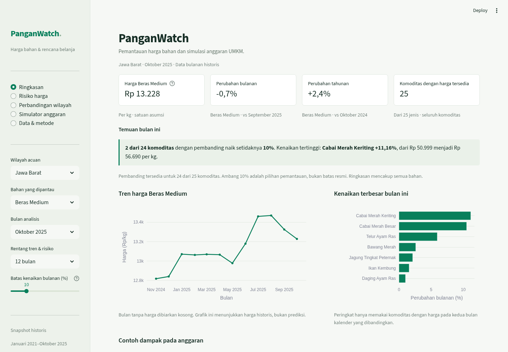

# PanganWatch

Dashboard harga pangan dan simulasi anggaran belanja untuk UMKM kuliner.

Pertanyaan awalnya sederhana: bahan apa yang sedang naik, dan berapa tambahan anggaran jika jumlah belanja tetap? Contoh penggunaan memakai bahan warung makan di Jawa Barat. Pilih wilayah, komoditas, dan bulan untuk melihat harga, kemudian coba skenario belanja. Harga konsumen provinsi dipakai sebagai acuan; harga pembelian usaha dapat berbeda.

PanganWatch dibuat dengan Python, Pandas, SQL/SQLite, Streamlit, Plotly, dan ekspor Excel.



## Unduh proyek

[Unduh paket analyst.zip](https://github.com/Granbe1l/Harga-Pangan-Dashboard/raw/refs/heads/main/reports/analyst.zip). Ekstrak ZIP tersebut, lalu buka folder **analyst**. Paket berisi kode, dataset lokal, laporan Excel, dan panduan menjalankan proyek.

## Menjalankan dashboard

Gunakan Python 3.12 dan jalankan perintah dari folder **analyst** yang sudah diekstrak.

```bash
python -m venv .venv
source .venv/bin/activate
python -m pip install -r requirements.txt
python scripts/prepare_data.py
streamlit run app.py
```

Pada Windows PowerShell, perintah aktivasinya:

```powershell
.venv\Scripts\Activate.ps1
```

Versi seluruh dependensi tersedia pada `requirements.lock.txt`. Dataset lokal sudah disertakan, sehingga dashboard tidak membutuhkan akun atau API key. Instalasi dependensi pertama kali memerlukan koneksi Internet.

## Halaman yang tersedia

1. **Ringkasan:** harga bahan pilihan, perubahan bulanan/tahunan, temuan bulan terpilih, tren harga, dan bahan dengan kenaikan terbesar.
2. **Risiko harga:** perbandingan fluktuasi harga dan kelengkapan bulan pengamatan.
3. **Perbandingan wilayah:** harga satu komoditas pada bulan yang sama di wilayah yang datanya tersedia.
4. **Simulator anggaran:** jumlah kebutuhan dan skenario perubahan harga dapat diubah per bahan.
5. **Data & metode:** asal data, hasil pembersihan, definisi perhitungan, serta unduhan data dan Excel.

Parameter di panel kiri berlaku pada halaman yang dibuka. Ambang kenaikan merupakan pilihan pengguna untuk pemantauan, bukan batas resmi.

Jawa Barat menjadi pilihan awal agar contoh yang dibuka pertama kali konsisten. Pilihan itu bukan hasil pemeringkatan wilayah. Beras medium dipakai sebagai bahan awal; pengguna dapat menggantinya tanpa mengubah perhitungan bahan lain.

## Contoh pembacaan

Pada **Oktober 2025 di Jawa Barat**, 25 komoditas memiliki harga, tetapi hanya **24** yang mempunyai pembanding September. Dari 24 komoditas tersebut, **dua naik setidaknya 10%**: cabai merah keriting **11,16%** dan cabai merah besar **10,52%**. Jumlah pembanding ditampilkan supaya komoditas tanpa harga bulan sebelumnya tidak dianggap stabil.

Untuk contoh keranjang enam bahan yang tersedia di simulator, kenaikan seluruh harga sebesar 10% mengubah estimasi belanja dari **Rp1.118.460 menjadi Rp1.230.306**, dengan tambahan **Rp111.846**. Kuantitas dalam contoh merupakan asumsi latihan, bukan data pembelian usaha. Jumlah kebutuhan dan perubahan harga tiap bahan dapat diganti.

## Dataset

File mentah memuat **33.422 baris**, dengan **32.480 observasi valid** setelah pembersihan. Sebanyak **938 harga kosong dan 4 harga nol** dipisahkan ke file karantina. Harga yang hilang tidak diisi secara otomatis.

Snapshot berisi **25 komoditas**, dari **Januari 2021 sampai Oktober 2025**, dengan kelengkapan yang berbeda antarseri. Terdapat 38 seri wilayah modern dan dua seri historis Papua; 40 seri tersebut bukan jumlah provinsi pada satu waktu. Seri historis dipisahkan agar perubahan cakupan wilayah tidak tersambung sebagai satu tren.

Sumber file adalah [salinan CSV publik oleh Achmad Ichzan](https://github.com/achmadichzan/Prediksi_Harga_Pangan_Nasional/blob/main/harga_pangan.csv). Penyedia salinan mencantumkan [Badan Pangan Nasional](https://data.badanpangan.go.id/datasetpublications/178/rata-rata-harga-pangan-bulanan-konsumen-provinsi) sebagai sumber asal. Salinan belum diverifikasi terhadap versi resmi terbaru. Detail sumber, hash file, dan batas penggunaan tersedia di [catatan sumber](docs/SOURCES.md).

## Perhitungan utama

- MoM membandingkan bulan kalender sebelumnya; YoY membandingkan bulan yang sama pada tahun sebelumnya.
- Jika bulan pembanding tidak tersedia, perubahan dibiarkan kosong.
- Fluktuasi relatif menggunakan koefisien variasi (CV), minimal tiga observasi pada seri yang sama.
- Median wilayah dihitung tanpa bobot dari wilayah dengan data pada bulan dan komoditas yang sama; bukan rata-rata nasional resmi.
- Simulator memakai harga tepat pada bulan pilihan. Jika harga bahan aktif tidak lengkap, total keranjang tidak ditampilkan sebagai total lengkap.
- Satuan kg/liter adalah asumsi kerja karena CSV sumber tidak memiliki kolom satuan.

Rumus dan contoh pemeriksaan tersedia di [metode perhitungan](docs/METHODOLOGY.md) dan [kamus data](docs/DATA_DICTIONARY.md).

## Menyiapkan data dan Excel

```bash
python scripts/prepare_data.py
python scripts/export_report.py
```

Hasil berada di `data/processed/`, `data/panganwatch.sqlite`, dan `reports/`. [SQL view](sql/analytics.sql) dan [contoh query](sql/analysis_queries.sql) dapat digunakan untuk menelusuri perhitungan.

Ringkasan hasil tersimpan di `reports/analysis_summary.md`. Temuan berlaku pada periode dan data yang disebutkan; angka simulator merupakan skenario, bukan bukti penghematan usaha.

## Pemeriksaan

```bash
python -m unittest discover -s tests -v
```

Tes mencakup parsing harga, data kosong, perubahan bulan kalender, simulator, perpindahan halaman, dan pembuatan Excel.

[Catatan CV dan wawancara](docs/CV.md) membantu menjelaskan proyek berdasarkan hasil yang dapat diperiksa ulang. Repositori proyek: [Granbe1l/Harga-Pangan-Dashboard](https://github.com/Granbe1l/Harga-Pangan-Dashboard).
