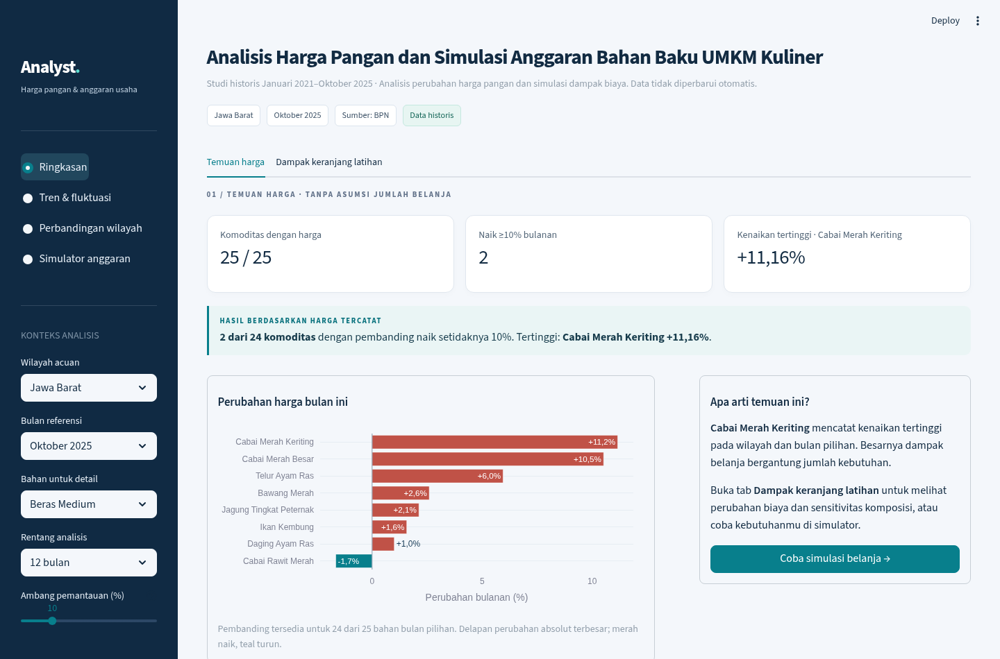

# Analisis Harga Pangan dan Simulasi Anggaran Bahan Baku UMKM Kuliner

[](https://github.com/Granbe1l/Harga-Pangan-Dashboard/actions/workflows/tests.yml)

Dashboard untuk menelusuri perubahan harga pangan bulanan dan menghitung pengaruhnya terhadap contoh anggaran bahan baku. Analisis awal berfokus pada Jawa Barat; wilayah lain dapat dipilih melalui filter.

**Python · Pandas · SQL/SQLite · Streamlit · Plotly · Excel**

[Buka dashboard](https://harga-pangan-dashboard-candy.streamlit.app/) · [Studi kasus](docs/CASE_STUDY.md) · [Sumber data](docs/SOURCES.md) · [Metode](docs/METHODOLOGY.md) · [Hasil pengujian](reports/validation_summary.md)



## Temuan utama

Pada **Jawa Barat, Oktober 2025**:

- Harga tersedia untuk **25 komoditas**; **24** memiliki pembanding September.
- **Dua komoditas naik setidaknya 10%**. Cabai merah keriting mencatat kenaikan tertinggi, **11,16%**.
- Cabai merah keriting naik setidaknya 10% pada **4 dari 12 pasangan bulan** dalam rentang November 2024–Oktober 2025. Angka ini menggambarkan riwayat yang tersedia, bukan peluang kenaikan berikutnya.
- Biaya keranjang enam bahan contoh bertambah **Rp10.687** dibanding September dengan jumlah belanja tetap. Nilai ini merupakan estimasi dengan satuan asumsi, bukan catatan pengeluaran usaha.

Ambang 10% dapat diubah dan bukan batas resmi pemerintah. Perincian komposisi dan sensitivitas keranjang tersedia dalam [studi kasus](docs/CASE_STUDY.md).

## Fitur

| Menu | Isi |
| --- | --- |
| Ringkasan | Perubahan harga bulan pilihan dan dampaknya pada keranjang contoh |
| Tren & fluktuasi | Riwayat bahan pilihan dan perbandingan fluktuasi pada bulan pengamatan yang sama |
| Perbandingan wilayah | Harga wilayah pilihan, median wilayah tersedia, dan selisih terhadap median |
| Simulator anggaran | Perubahan jumlah, harga, satuan, skenario kenaikan, dan batas anggaran; ekspor CSV/Excel |

Bagian **Sumber & cara menghitung** tersedia di bawah setiap halaman. Filter dan isian simulator bertahan selama sesi. Input tidak disimpan permanen.

## Data

Sumber: [Badan Pangan Nasional — Rata-rata Harga Pangan Bulanan Tingkat Konsumen Provinsi](https://data.badanpangan.go.id/datasetpublications/178/rata-rata-harga-pangan-bulanan-konsumen-provinsi).

Dataset mencakup **Januari 2021–Oktober 2025**, dengan **33.422 baris mentah**, **32.480 observasi valid**, dan **942 baris yang dipisahkan**: 938 harga kosong dan empat harga nol. CSV digunakan untuk pemrosesan; XLSX disimpan sebagai pembanding. Seluruh baris kedua format cocok setelah normalisasi teks.

Berkas diterima sebagai ekspor dari publikasi tersebut. Pemeriksaan dilakukan pada berkas lokal; unduhan langsung dari server tidak diverifikasi secara independen. Nama berkas, hash, dan hasil pencocokan tersedia pada [catatan penerimaan](data/raw/primary/receipt.json).

### Batas penggunaan

- Data bersifat historis dan tidak diperbarui otomatis.
- Harga konsumen provinsi dapat berbeda dari harga toko atau pemasok.
- File sumber tidak mencantumkan satuan. Kg/liter dalam keranjang contoh merupakan asumsi; satuan input simulator merupakan pernyataan pengguna.
- Harga kosong tidak diisi. Tanda **—** berarti belum dapat dihitung; total tidak lengkap ditampilkan sebagai subtotal.
- Simulasi belum mencakup ongkir, susut, stok, dan biaya operasional. Hasilnya bukan prediksi harga atau bukti penghematan usaha.

Rincian pembersihan dan rumus tersedia di [metodologi](docs/METHODOLOGY.md) dan [kamus data](docs/DATA_DICTIONARY.md).

## Menjalankan aplikasi

Gunakan Python **3.12**, lalu jalankan dari root repository:

```bash
python3.12 -m venv .venv
source .venv/bin/activate
python -m pip install -r requirements.lock.txt
streamlit run app.py
```

Untuk Windows PowerShell, buat lingkungan dengan `py -3.12 -m venv .venv` lalu aktifkan melalui `.venv\Scripts\Activate.ps1`. Data sudah disertakan; aplikasi tidak membutuhkan API key.

[Paket unduhan](https://github.com/Granbe1l/Harga-Pangan-Dashboard/raw/refs/heads/main/reports/analyst.zip) tersedia dengan folder utama `analyst`. Panduan hosting tersedia di [Deployment](docs/DEPLOYMENT.md). Akses aplikasi publik belum tercakup dalam pemeriksaan lokal.

## Struktur proyek

| Folder | Isi |
| --- | --- |
| `analyst/` | Pembersihan data, perhitungan, simulasi, dan ekspor laporan |
| `data/` | Berkas sumber, metadata, hasil pembersihan, dan SQLite |
| `sql/` | Query analisis |
| `tests/` | Pengujian otomatis |
| `reports/` | Laporan, screenshot, dan paket aplikasi |
| `docs/` | Studi kasus, sumber, metode, dan panduan teknis |

## Pengujian dan laporan

```bash
python -m unittest discover -s tests -v
python scripts/export_report.py --output-dir /tmp/analyst-report
python scripts/package_project.py
```

Pengujian mencakup perbandingan kalender, harga kosong, perhitungan anggaran, sumber harga per bahan, ekspor, dan perpindahan halaman. GitHub Actions menjalankan tes pada push dan pull request. Petunjuk pemeriksaan browser tersedia di [Testing](docs/TESTING.md).
